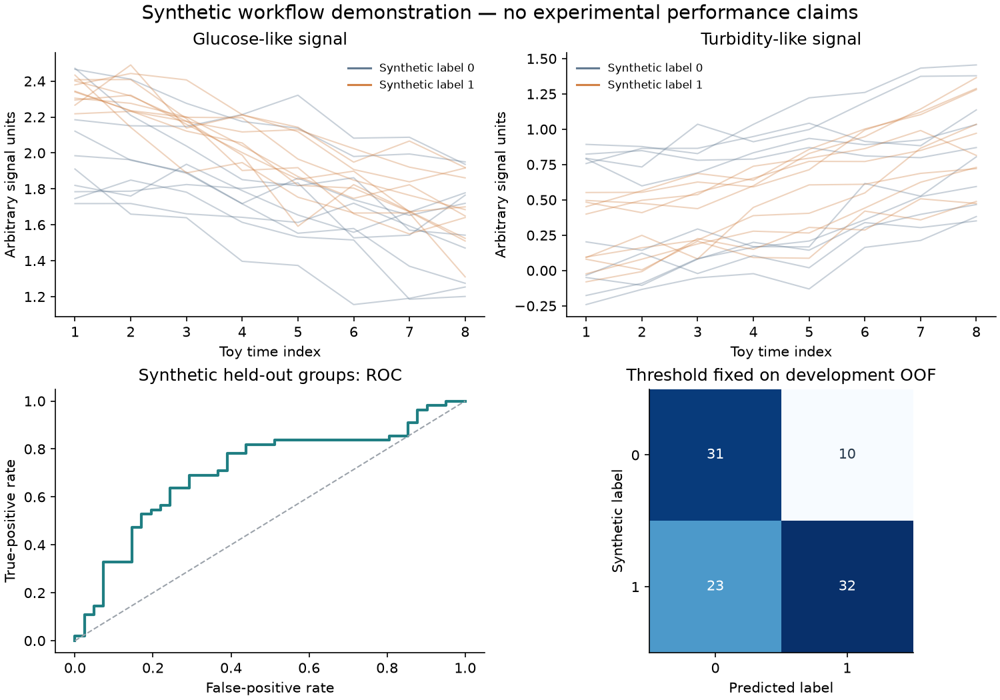

# Glucose–turbidity analysis of bacterial drug responses

[](https://github.com/yzdeng1417/glucose-turbidity-ml/actions/workflows/checks.yml)

Reproduce the paper's main growth-classification and MIC results from de-identified
real observations with paired glucose (GLU) and turbidity (NTU) time series.
The release includes **1,605 pure-culture observations from 43 strains** and
**168 observations from eight BALF fluid specimens**, their manual endpoint growth
labels, full drug context, frozen group splits, fixed predictions and MIC references.

Glucose-related signals and culture turbidity describe different aspects of
bacterial responses to antibiotics. Studying them together may inform future
phenotypic susceptibility testing. Their divergence does not itself establish
survival, killing, tolerance or persistence. The model predicts a binary growth
endpoint per observation; series-level MIC estimates are calculated separately.
Scores are uncalibrated. This research software does not establish faster testing,
improved patient outcomes or suitability for treatment decisions.

## Quick recomputation from saved predictions

Use Python 3.12 or later. This mode needs no PyTorch and fits no models.

```bash
git clone https://github.com/yzdeng1417/glucose-turbidity-ml.git
cd glucose-turbidity-ml
python -m venv .venv
source .venv/bin/activate
python -m pip install .
glu-ntu-reproduce --mode saved --output outputs/paper-saved
```

On Windows PowerShell, activate with `.venv\Scripts\Activate.ps1`.
`python -m cmp` runs this real-data workflow too. The default mode is `saved`.
Choose a new output directory for each run; existing evidence is never overwritten.

Open `report.md`, `classification_metrics.tsv`, `mic_summary.json` and
`reconciliation.json` in the selected output directory. The command recomputes
metrics and all MIC series from the frozen scores rather than copying the
published summaries.

| Result | Recomputed value |
|---|---:|
| Pure-culture series retained | 228 |
| Pure-culture reportable MICs, including bounds | 194/228 |
| Pure-culture exact numeric comparison denominator | 82 |
| Pure-culture EA (within one twofold dilution) | 72/82 |
| Pure-culture exact agreement | 51/82 |
| BALF reportable/comparable specimens | 4/8 |
| BALF EA | 4/4 |
| BALF range-adjusted exact agreement | 3/4 |

Pure-culture outputs retain 112 bounds and 34 NR series. BALF outputs retain
all eight specimens, with four NR results. Range-adjusted equality describes
compatibility of reported ranges; it does not equate unknown exact MIC values.

## Full main-model retraining

Use **Python 3.12.11** and the reference dependencies. This mode actually trains
25 outer-fold members and five final members, saves their checkpoints and
histories, and compares new scores, calls, fit epochs, metrics and every MIC
record with the frozen paper evidence.

```bash
# In a fresh environment created with Python 3.12.11:
python -m pip install -r requirements-paper.txt
python -m pip install --no-deps .
glu-ntu-reproduce --mode train --output outputs/paper-train
```

The paper model uses T1-centered eight-point trajectories (30–135 minutes),
optimizer-only scaling, five grouped outer folds, seeds 42–46 and grouped early
stopping. It directly consumes the frozen row roles, so anonymous group names
cannot alter the folds. The main threshold is fixed at **0.5**; no threshold is
optimized by either reproduction mode. All 30 fits use CPU and two torch threads.

The strict reconciliation policy was frozen before retraining: every member and
ensemble score must differ by at most 1e-7, with no changed well calls or MIC
records and matching stopping histories' best/run epochs. A mismatch preserves
outputs and exits nonzero; labels, thresholds and folds are never adjusted to
force a match. Different hardware/builds can fail this strict comparison even
with the same package versions. `saved` is a quick recomputation, not full training.

BALF is a **previously examined retrospective feasibility cohort**, not untouched
external validation. Its eight specimens come from six participant groups;
the four comparable specimens come from three groups. The 0.5 rule and temporal
representation were adopted after reviewing existing results. Species context
for BALF was obtained by subsequent pure-culture identification. Real no-drug
negative labels remain intact. See [data and methods](docs/data-and-methods.md)
for the full protocol, source limitations and MIC rules.

## Files and outputs

The installed package includes [the real dataset](src/cmp/data/paper-v1/), with
SHA-256 verification, manual labels, anonymous group relations, full drug context,
MIC qualifiers, frozen splits, fixed five-member/ensemble scores and reference
records for reconciliation. It does not require an internal path or identity map.

| Output | Contents |
|---|---|
| `development_predictions.tsv`, `balf_predictions.tsv` | Every well, label, score, member scores, fixed-threshold call and anonymous metadata |
| `classification_metrics.tsv`, `development_fold_metrics.tsv` | Overall, drug-exposed, no-drug and outer-fold summaries |
| `development_mic.tsv`, `balf_mic.tsv` | Every series, reference, range symbol, NR/exclusion reason and source public row IDs |
| `balf_concentration_votes.tsv` | Three-well binary votes at each measured concentration |
| `mic_summary.json`, `report.md` | Complete MIC denominators and readable real-data results |
| `split_manifest.tsv`, `protocol.json`, `reconciliation_policy.json` | Frozen role, model and numeric comparison rules |
| `reconciliation.json`, `run_manifest.json` | Checks, mode/fit count, environment and input/code/output hashes |
| `models/*.pt`, `models/*.history.tsv`, `fit_summary.tsv` | Train mode only: local checkpoints, scaling, optimizer/stopping indices and epochs |

## Explicit synthetic teaching examples

The earlier simplified examples remain available through a separate command.
Their labels and results are synthetic and do not reproduce paper model results.

```bash
glu-ntu-demo --output outputs/synthetic
# Smaller equation-based example:
glu-ntu-demo --dataset toy --seed 2026 --output outputs/toy
# Optional simplified neural example (requires torch):
glu-ntu-demo --model neural --epochs 15 --output outputs/synthetic-neural
```



See [synthetic data and methods](docs/synthetic-data-and-methods.md) for the
preserved teaching protocol. The main release does not rerun all representation
comparisons or the eight-way ablations.

## Experimental data collection template

The existing [blank interlaboratory collection template](templates/interlaboratory-data-collection/)
remains available and versioned separately. It records experimental conditions,
per-well paired GLU–NTU time series and independent references using de-identified
specimen codes.

## Checks

```bash
python -m pip install '.[dev]'
python -m pytest -q
python -m ruff check .
```

Tests cover package checksums, real cohort counts and negative controls, frozen
group isolation, anonymous renaming, MIC bounds/skips, complete saved recomputation
and the preserved teaching examples. Full retraining is a separate explicit run.

## Licenses and attribution

Code and the existing synthetic teaching example remain [MIT](LICENSE).
The new real dataset is [CC BY 4.0](LICENSE-DATA). Credit
**glucose-turbidity-ml data contributors (yzdeng1417)**, link to this repository
and the license, identify `paper-centered-real-v1` and the release/commit used,
and indicate any changes. Clinical source reports and internal identity mappings
are not included in the public package.
